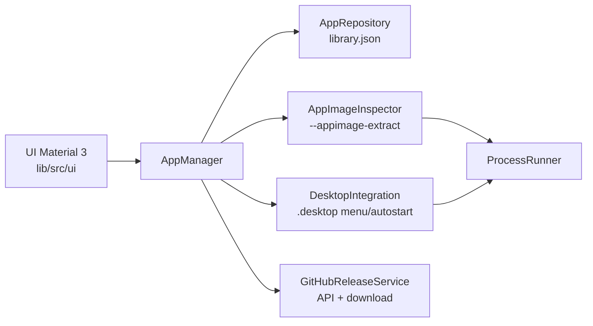
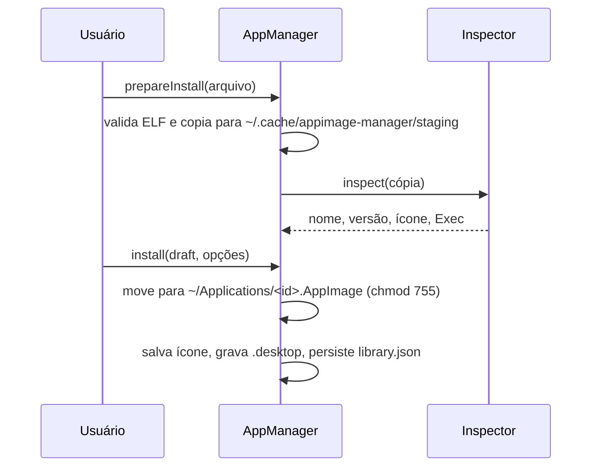

# Arquitetura

O app é um projeto Flutter desktop para Linux. A interface depende de um único `ChangeNotifier`, o `AppManager`, que orquestra serviços sem dependência de UI.

## Camadas

| Arquivo | Responsabilidade |
| --- | --- |
| `models/managed_app.dart` | Estado persistido de cada AppImage |
| `models/github_source.dart` | Repositório, padrão de asset e pré-lançamentos; aceita `dono/repo` e URLs |
| `services/app_paths.dart` | Caminhos XDG (config, dados, cache, autostart) |
| `services/app_repository.dart` | Leitura e gravação atômica do `library.json` |
| `services/appimage_inspector.dart` | Detecta o tipo do AppImage e extrai `.desktop` e ícone, seguindo symlinks internos |
| `services/desktop_entry.dart` | Parser e escrita de `.desktop`, incluindo as regras de aspas do `Exec` |
| `services/desktop_integration.dart` | Cria e remove entradas de menu e autostart |
| `services/github_release_service.dart` | Consulta releases, escolhe o asset e faz download com progresso |
| `services/version.dart` | Comparação de versões no estilo semver |
| `services/app_manager.dart` | Fluxos de instalação, atualização, remoção e estado da UI |

## Fluxo de instalação

A pasta de staging fica em `~/.cache` e não em `/tmp` porque algumas distribuições montam `/tmp` com `noexec`, o que impediria a leitura dos metadados.

## Substituição segura

Toda troca de executável copia para `<destino>.part`, aplica `chmod 755` e faz `rename`, que é atômico no mesmo sistema de arquivos. Um aplicativo aberto continua rodando com o binário antigo até ser fechado.

## Testes

- `test/*_test.dart` cobre parser de `.desktop`, versões, GitHub (com `MockClient`), inspeção e fluxos completos do `AppManager` em um diretório temporário.
- `test/widget_test.dart` cobre a tela inicial e a navegação para detalhes.
